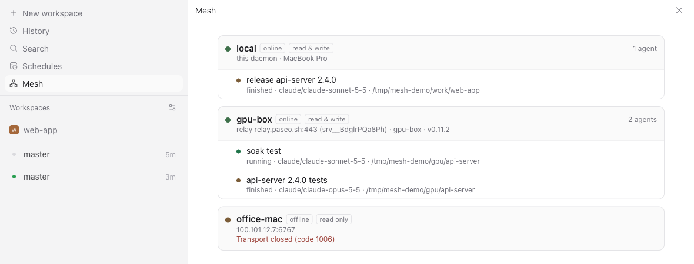
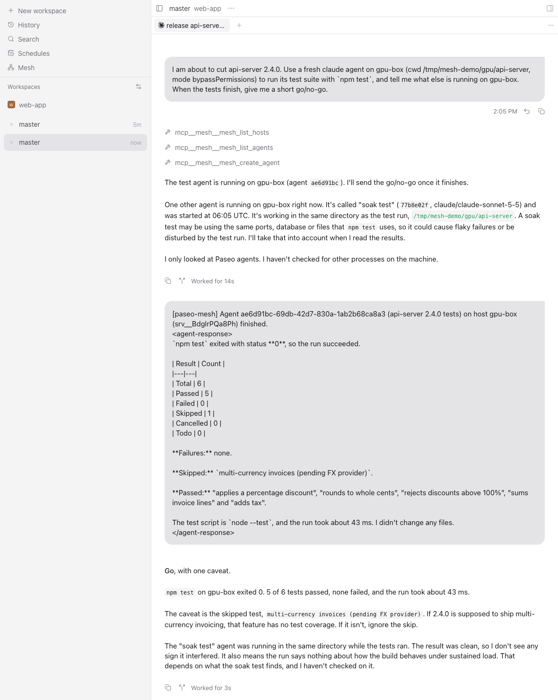

# paseo-mesh

这是 [jtsang4/paseo-mesh](https://github.com/jtsang4/paseo-mesh) 的 Blinklab 维护分支。通信库固定使用 Paseo 0.12.0，避免旧版巨型消息校验函数触发 Maglev 编译内存高峰。通过本仓库分发安装包，不发布到 npm；保留原 MIT 许可证及作者署名。

一个 [Paseo](https://paseo.sh) 插件。装了它之后，一台 Paseo host 上的 agent 可以查看和驱动你其他 host 上的 agent。

Paseo 自带的编排能力（`create_agent`、`send_agent_prompt`、完成通知）只在单个 daemon 内有效。paseo-mesh 把它扩展到多台机器：笔记本上的 agent 可以列出 GPU 服务器上的 agent，读取它们的时间线，在那边创建新 agent、发送后续指令、处理它们的权限请求，并在它们完成时收到消息。

[English](README.md)



```
笔记本（安装 paseo-mesh）                          gpu-box、office-mac（普通 Paseo）
┌────────────────────────────────────┐
│ agent ── mesh MCP 工具 ──► 插件     │── Relay（端到端加密）或直连 WebSocket ──► daemon
│                             │      │──────────────────────────────────────► daemon
│      ◄── "agent X 已完成" ───┘      │
└────────────────────────────────────┘
```

只有负责编排的 host 需要安装插件。peer 就是能配对的普通 Paseo daemon。

## 功能

- **给 agent 的 mesh 工具。** 安装后新建的 agent 会带上 `mesh` MCP server，包含 `mesh_list_hosts`、`mesh_list_workspaces`、`mesh_list_agents`、`mesh_get_agent`、`mesh_read_timeline`、`mesh_list_providers`、`mesh_create_agent`、`mesh_send_prompt`、`mesh_wait_agent`、`mesh_respond_permission`、`mesh_stop_agent`、`mesh_archive_agent`。
- **跨 host 完成通知。** agent 在远端创建或指挥的 agent 完成、出错或请求权限时，会收到一条消息，格式和 Paseo 自己的通知一致。
- **直接执行脚本。** `mesh_exec` 在 POSIX host 上执行 shell 脚本，一次调用返回合并后的输出和退出码，执行结束后自动清理临时终端。
- **支持 Paseo 的所有连接方式。** 配对 offer URL 和 `relay://` URI（经 Paseo relay 端到端加密，不用开端口），或者直连 `host:port` / `ws://` / `wss://`，可带 daemon 密码（Tailscale、局域网、反向代理）。
- **按 host 控制权限。** 每个 peer 可以设为只读或读写，还可以限制允许的路径。
- **App 界面。** 侧边栏的 Mesh 页面显示各 host 状态和所有 agent；Peers 设置页用来增删改 peer。
- **无界面管理。** 提供 `paseo-mesh` 命令行，适合没有 App 的服务器。

## 环境要求

- 编排 host 上的 Paseo daemon 与 App 为 0.12.0 或更新，并且开启了插件。
- peer：编排 host 能通过 relay 或直连访问到的任意 Paseo daemon。
- 用 Git 安装时，编排 host 上需要 Node.js 和 npm（Paseo 会运行 `npm ci --omit=dev` 安装插件依赖）。

## 安装

插件不在沙箱里运行，拥有 daemon 用户的全部权限。只安装你信任的代码。

1. 在编排 host 上开启插件：App 里打开 **Settings → Plugins → Enable plugins**，或在 `~/.paseo/config.json` 里设置 `"pluginsEnabled": true` 后运行 `paseo reload`。
2. 从维护仓库安装，保留 `mesh` 安装 ID，以继续使用现有主机配置和会话工具地址：

   ```bash
   paseo plugin install git:LuoSK/paseo-mesh --id mesh
   ```

   如需固定已审核的版本，追加 `--ref <提交编号或标签>`。本维护版不要使用上游插件目录或 npm 的安装命令。

   从现有安装切换时，先私下备份旧插件源码及 `$PASEO_HOME/paseo-mesh/`，再运行 `paseo plugin remove mesh`，然后执行上面的安装命令。Paseo 不允许直接覆盖已配置的 ID。移除操作会删除旧托管插件和通用插件设置，但不会删除 Mesh 独立保存的主机、调用者及 MCP 端口状态目录；不要删除这个目录。切换会短暂中断 Mesh 工具和通知，不需要重启 Paseo daemon。

3. 确认它在运行：

   ```bash
   paseo plugin ls
   paseo plugin logs mesh
   ```

以后用 `paseo plugin update mesh` 更新。

## 连接你的 host

agent 只能访问 mesh peer 列表里的 host。有两种方式填充这个列表。

### 从 App 自动同步

在 **Settings → Plugins → mesh → Peers → Sync hosts from this app** 里打开 **Keep peers in step with this app's hosts**。Paseo 桌面版或 Web 版开着的时候，mesh 会让自己的 peer 和 App 的主机列表保持一致：App 里新加的主机自动变成 peer，连接方式变了会跟着更新，从 App 删除的主机也会被移除。你手动加的 peer 不会被改动；同步来的 peer 被你手动删除后，除非你主动恢复，否则不会再同步回来。同步来的 peer 使用你为同步设置的权限，默认只读。

每台装了 mesh 的 host 都会这样同步自己的 peer，headless 服务器也一样：你用来连 Linux 服务器的那个 App，会顺便把那台服务器上 mesh 的 peer 也同步好。对每台主机，mesh 会挑一种从发起连接的 daemon 那边连得通的方式：

1. App 里的 relay 连接（配对链接）；
2. 对方 mesh 发布的配对链接（对方开了 relay 时可用，headless 服务器就是靠它连回运行 App 的笔记本）；
3. 发起方能直接路由到的 `host:port`（回环地址只对和 App 在同一台机器上的 daemon 有效）；
4. SSH，使用 daemon 用户自己的 SSH 密钥和配置。

没有可用连接方式的主机会列在 **Not synced** 里，并说明原因。

同步读取的是 App 内部存储的主机列表，Paseo 没有把它开放给插件，所以只在桌面版和 Web 版可用。将来 Paseo 改了这个存储格式时，mesh 会停止同步并报告问题，不会去猜。App 里保存的主机密码会被复制到各台 daemon 的 mesh 配置里。

### 手动添加

给每台要访问的机器拿一个配对链接：可以在 App 里打开 **Settings → 那台主机 → Pair device** 复制链接，也可以在那台机器上运行：

```bash
paseo daemon pair            # 输出 https://app.paseo.sh/#offer=...
```

配对链接要像密码一样保管：拿到它就能控制那台 daemon。然后在编排 host 上添加 peer，可以在 App 里操作（**Settings → Plugins → mesh → Peers → Add a peer**），也可以用命令行：

以下命令从本维护仓库的源码目录运行，先执行 `npm ci --omit=dev` 安装锁定依赖；这样不会通过 `npx` 意外运行 npm 上的旧版插件。

```bash
node bin/paseo-mesh.mjs peers add gpu-box 'https://app.paseo.sh/#offer=...' --write
node bin/paseo-mesh.mjs peers add office-mac 100.64.0.7:6767 --password-stdin < password.txt
node bin/paseo-mesh.mjs peers add devbox 'ssh://dev@devbox-cn?daemonPort=6767'
node bin/paseo-mesh.mjs status
```

| 连接方式 | 适用场景 |
| --- | --- |
| `https://app.paseo.sh/#offer=…` 或 `relay://…` | peer 能出公网。在 NAT 和防火墙后面也能用，流量端到端加密。自建 relay 同样可用：offer 里带着 relay 地址。 |
| `host:port`、`ws://…`、`wss://…` | 两台机器在同一网络（Tailscale、局域网、VPN、反向代理）。给 peer 设置 daemon 密码，并把密码填给 mesh。 |
| `ssh://[user@]host[:port]?daemonPort=6767` | 你本来就能 SSH 到那台机器。mesh 用 `ssh -W` 连到 daemon，使用 daemon 用户的密钥、agent 和 `~/.ssh/config`，以批处理模式运行，所以密钥必须无需交互就能用。 |

peer 默认是**只读**。授予**读写**后，agent 才能在那边创建和控制 agent；设置允许路径可以把它们限制在指定目录里。

## 使用

安装之后新建的 agent 都带有 mesh 工具，直接用自然语言吩咐它：

> 在 gpu-box 的 /srv/models/llm 上开一个 codex agent 跑评测，完成后把结论告诉我。

> office-mac 上的 agent 现在都在做什么？

> 读一下 gpu-box 上 review agent 最后几条消息，把我的意见发给它。

agent 调用 `mesh_create_agent` 后会继续做别的事。远端 agent 完成时，调用方会收到类似这样的消息：

```
[paseo-mesh] Agent 3f2c… (eval-suite) on host gpu-box (srv_…) finished.
<agent-response>
All 412 cases passed …
</agent-response>
```

下图中，笔记本上的 agent 在 gpu-box 上跑发布前检查：它先查看有哪些 host、gpu-box 上还在跑什么，然后创建测试 agent，自己去做别的事。远端 agent 完成后，报告以消息形式送回，笔记本上的 agent 据此给出能否发布的结论：



在 App 侧边栏打开 **Mesh**，可以看到所有 host 和它们的 agent。如果 App 也连着某台 host，点那台 host 上的 agent 可以直接打开。

### 不同 host 上的 agent 互相对话

用 `mesh_send_prompt` 或 `mesh_create_agent` 发出的消息，开头会带上发送方和回复方法：

```
[paseo-mesh] Message from agent 3f2c… on host MacBook Pro, srv_….
To reply, call mesh_send_prompt with host "srv_…" and agentId "3f2c…".
```

两台 host 都装了 mesh 并互相配成 peer 后，收到消息的 agent 可以用 `mesh_send_prompt` 回复，两台机器上的 agent 就能来回对话。回复地址用的是发送方 daemon 的 `serverId`，不管对方给这个 peer 起了什么名字都能用。传 `includeSender: false` 可以只发原始内容。如果发送方开了完成通知，消息头会告诉接收方“最终回复会自动送达”，避免重复回复。

工具列表、权限要求和配置项见[英文 README](README.md#tools)。

直接运行脚本时，先为目标 peer 授予读写权限，并在 Mesh 设置中开启 **Allow shell execution**，或运行 `paseo-mesh peers set gpu-box --write --allow-exec`。然后调用 `mesh_exec`：

```json
{"host":"gpu-box","cwd":"/srv/project","script":"bash scripts/check.sh","timeoutSeconds":50}
```

调用会等待执行结束，返回 `output`（合并的 stdout 和 stderr）、`exitCode`、`timedOut`、`truncated`、`error` 和 `cleanupPending`。输出保留 UTF-8 文本、换行和 ANSI 序列。`shell` 默认 `/bin/sh`，`maxOutputChars` 默认 200,000，最多 2,000,000；超时默认 50 秒，最多 600 秒，包含准备时间，应小于 MCP 客户端的工具超时。脚本的 stdin 关闭。超时或连接失败时返回已收集的输出和错误，脚本不会自动重试。完成、超时、取消和插件关闭时都会清理临时终端；断线或插件意外退出后，远端存活时限会终止终端，重连和重载也会清理残留。`cleanupPending` 表示尚未确认远端清理完成。本机执行需开启 `localAllowExec`，或运行 `paseo-mesh settings --local-allow-exec`。

## host 变化时的行为

| 事件 | 行为 |
| --- | --- |
| peer 改名 | 连接不断开。待发的通知跟着这个 peer 走，并使用新名字。旧名字不再生效，peer id 和 server id 继续可用。 |
| 修改连接、密码或启用状态 | peer 用新设置重新连接。 |
| peer 离线、daemon 重启、网络中断 | 指数退避重连（1 秒到 30 秒，带抖动）。待发通知会等待，重连后继续；断线期间结束的回合也会补报。 |
| 删除 peer | 待发通知保留。24 小时内同一台 daemon 以任何名字重新加回来，通知会继续；否则告诉调用方为什么停止了。 |
| 远端 agent 被删除 | 告诉调用方这个 agent 已经不存在。 |
| 调用方 agent 被归档或删除 | 丢弃这条通知。 |
| peer 指回本机 daemon | 作为自环拒绝。 |
| 两个 peer 指向同一台 daemon | 第二个被标记为重复，直到第一个被删除。 |
| offer 和 daemon 不匹配 | 拒绝：握手返回的 server id 必须与 offer 一致。 |
| 插件重载或 daemon 重启 | peer 自动重连，待发通知从磁盘恢复；MCP 端口和 token 保持不变，已有 agent 的工具继续可用。 |
| 手动编辑 `config.json` | 保存后立即生效。没有 id 的 peer 会自动分配 id。文件无效时在状态里报错，并继续使用上一份有效配置。 |

## 安全

- **信任边界。** 配对 offer 或 daemon 密码等于那台 daemon 的完全控制权。Paseo 目前还不能签发受限凭据，所以读写权限和允许路径由 mesh 自己执行。它们是给 agent 的护栏，不是沙箱：peer 上的符号链接不会被解析。
- **脚本执行**默认关闭，同步来的 peer 也一样。开启 `allowExec` 后仍需读写权限，`localAllowExec` 控制本机执行。脚本以目标 daemon 用户运行，允许路径仅限制初始工作目录，不限制后续文件访问和命令。目标需为有 `/bin/sh`、`stty` 且支持 workspace terminal 的 POSIX host。
- **App 主机同步**在 App 内部读取 Paseo 保存的主机列表（超出插件 API 的范围），并把 relay 密钥、地址和密码复制到运行 mesh 的 daemon 上。默认关闭。
- **机密只留在本机。** offer 和密码保存在 `$PASEO_HOME/paseo-mesh/config.json`（权限 0600），RPC 和状态页面都不会返回它们。
- **本地端点。** MCP server 只监听 `127.0.0.1`，使用随机 bearer token，保存在 `$PASEO_HOME/paseo-mesh/server.json`（0600）。这个 token 会注入到 agent 的 MCP 配置里，Paseo 把它保存在 agent 记录中。
- **Relay。** relay 流量使用 Paseo 的端到端加密，relay 只能看到元数据。

## 限制

- 安装插件之前创建的 agent 没有这些工具，需要新建 agent。
- App 主机同步需要桌面版或 Web 版开着，手机 App 不能同步。
- 不同 host 之间不共享文件，需要通过 git 或消息交接工作。
- 停止本机上的回合请用 Paseo 自带的 `cancel_agent` 工具。
- 不支持在同一个 daemon 上装两份 mesh，它们会共用一个数据目录。
- 启动时如果之前保存的 MCP 端口被其他程序占用，mesh 会换一个端口，之前创建的 agent 会失去 mesh 工具。

## 开发

```bash
npm install
npm run typecheck
npm run lint
npm test               # 单元测试
npm run test:e2e       # 用 @getpaseo/cli 启动隔离的 daemon，不会动 ~/.paseo
MESH_E2E_RELAY=1 npm run test:e2e   # 额外测试经 relay.paseo.sh 的连接
```

端到端测试使用真实 daemon 和一个确定性的 echo provider（`test/fixtures/echo-provider`），不需要任何模型凭据。内部设计见 [docs/architecture.md](docs/architecture.md)，开发流程见 [CONTRIBUTING.md](CONTRIBUTING.md)。

## 许可证

[MIT](LICENSE)
